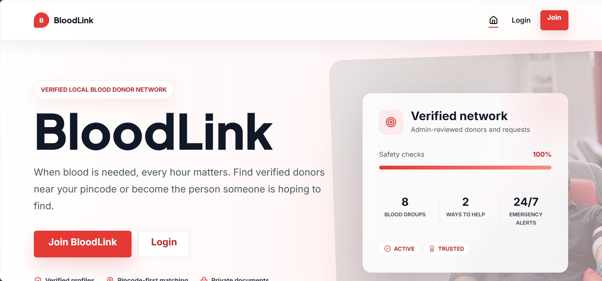
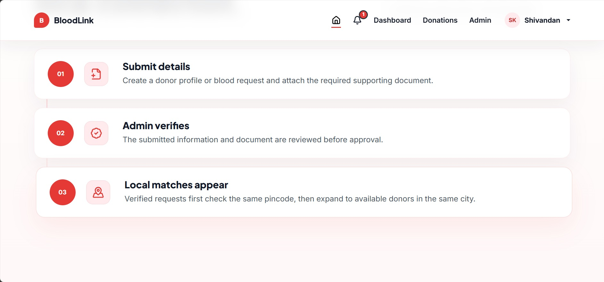

# Shivnandan Kumar - Python & Flask Developer

A responsive personal portfolio showcasing my Python and Flask work, selected projects, skills, education, and contact information.

## Live Demo

[View the portfolio](https://shivnandan-portfolio.onrender.com/)

## Screenshots

The repository includes these screenshots from BloodLink:





The E-Governance project is represented by an illustration in the portfolio; no project screenshot is included.

## Key Features

- Separate responsive pages for Home, Projects, About, Skills, and Contact.
- Project case studies for BloodLink and the E-Governance Complaint and Service Management Portal, with repository and demo links.
- Confirmed profile and education details, grouped skills, and a downloadable resume.
- Accessible icon navigation with a floating mobile dock, keyboard focus states, reduced-motion support, and responsive layouts.
- SEO metadata, an SVG favicon, and generated `robots.txt` and `sitemap.xml` routes.
- Contact form submits from the browser to Web3Forms, with required-field checks, a hidden honeypot, loading feedback, and success or error status.

The contact submission goes directly from the browser to Web3Forms. It does not use Flask-WTF server-side validation or Flask CSRF validation; browser checks can be bypassed. The Web3Forms access key appears in rendered client-side markup and is public by design. Never commit a real key.

## Tech Stack

- Python 3 and Flask
- Jinja-rendered HTML, CSS, and JavaScript
- Flask-WTF and WTForms for form field rendering and validators (the current direct Web3Forms submission bypasses Flask form processing)
- Gunicorn as the production WSGI server
- pytest for automated tests
- Render for hosting; Web3Forms for contact message delivery

The portfolio does not use a database, authentication, or an admin panel. Technologies listed for BloodLink describe that separate project and are not dependencies of this portfolio.

## Project Structure

```text
.
|-- app.py                       # Flask application factory and routes
|-- forms.py                     # Contact form fields and validators
|-- project_data.py              # Project case-study content
|-- render.yaml                  # Render Blueprint configuration
|-- requirements.txt             # Runtime dependencies
|-- requirements-dev.txt         # Runtime dependencies plus pytest
|-- static/
|   |-- css/styles.css            # Responsive styles and accessibility states
|   |-- documents/                # Downloadable resume
|   |-- images/                   # Profile and project screenshots
|   |-- js/                       # Contact form and scroll-reveal behavior
|   `-- favicon.svg
|-- templates/                    # Page templates and shared sections
`-- tests/test_routes.py          # Route and contact-form contract tests
```

`email_service.py` and `smtp_diagnostic.py` are retained legacy SMTP files. They are not used by the production contact-form flow.

## Installation and Local Setup

Requirements: Python 3.9 or newer and pip.

In PowerShell, from the project directory:

```powershell
python -m venv .venv
.\.venv\Scripts\Activate.ps1
python -m pip install -r requirements-dev.txt
```

If PowerShell prevents virtual-environment activation, install and run through `.venv\Scripts\python.exe` instead.

## Environment Variables

| Variable | Purpose |
| --- | --- |
| `SECRET_KEY` | Flask session and CSRF signing key. Render must have this set; `render.yaml` generates one. |
| `WEB3FORMS_ACCESS_KEY` | Web3Forms key inserted into the client-side form. It is public in the rendered page; use the placeholder in `.env.example` only as a reference. |

The application does not automatically load `.env` files. Set variables in your shell or deployment settings. Do not put a real access key or secret in Git or share it in chat.

## Running the Application

```powershell
python -m flask --app app run
```

Open <http://127.0.0.1:5000>. The project detail routes are `/projects/bloodlink` and `/projects/egovernance`; generated SEO routes are `/robots.txt` and `/sitemap.xml`.

## Running Tests

```powershell
python -m pytest
```

The automated tests cover public routes, page/navigation content, and contact-form markup and client-script contracts. They mock or inspect integrations rather than sending a real contact message.

## Deployment

The portfolio is hosted on Render at [shivnandan-portfolio.onrender.com](https://shivnandan-portfolio.onrender.com/). The repository's `render.yaml` defines a Python web service with:

- Build command: `pip install -r requirements.txt`
- Start command: `gunicorn app:app --bind 0.0.0.0:$PORT`
- Generated `SECRET_KEY` and a `WEB3FORMS_ACCESS_KEY` value supplied through Render settings

Contact delivery uses the Web3Forms API from the visitor's browser; Gmail SMTP is not part of the production contact flow. Web3Forms domain approval and successful form delivery should be verified for the deployed domain.

## Contact

- GitHub: [shivnandan-kumar](https://github.com/shivnandan-kumar)
- LinkedIn: [Shivnandan Kumar](https://linkedin.com/in/shivnandan-kumar-27804b3a9)
